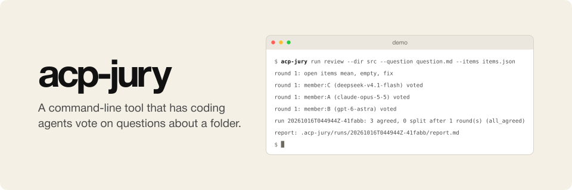

<p align="center"></p>

# acp-council

acp-council is an LLM council whose members are coding agents, such as Claude Code, Codex and Pi. Each member answers
the same question with its own tools, and when their answers differ, the members read each other's answers and answer
again. It runs from the command line or as a TypeScript library.

In `blind` mode, each agent votes alone. In `discuss` mode, the agents vote alone first, then read each other's
arguments and vote again on the items they disagree on, for 5 rounds or as many as you set. Items that stay split
go to you.
The agents see each other only by anonymous labels such as `member:A`. Each one works in its own copy of the
folder, so your folder never changes.

## Requirements

- Node.js 22.18 or newer, and pnpm.
- Each agent you want to use, installed and logged in: Claude Code, Codex, or Pi with the providers you need.
  acp-council starts each agent's [ACP](https://agentclientprotocol.com) adapter with `npx` and uses your existing
  logins.

## Install

```bash
git clone https://github.com/osolmaz/acp-council
cd acp-council
pnpm install
pnpm run build
pnpm link --global
```

## Quick start

1. Name your members in `~/.acp-council/members.json`:

   ```json
   {
     "claude-opus-5-5": { "agent": "claude", "model": "claude-opus-5-5" },
     "gpt-6-astra": { "agent": "codex", "model": "gpt-6-astra" }
   }
   ```

   `model` is the model ID with its version. When the agent does not know the ID, the error lists the models that
   the agent offers.

2. Name a council in your repository, in `.acp-council/councils/review.json`:

   ```json
   { "mode": "discuss", "members": ["claude-opus-5-5", "gpt-6-astra"] }
   ```

3. List the items to vote on in `items.json`:

   ```json
   [
     { "id": "mean", "text": "The function returns the mean of a non-empty list." },
     { "id": "empty", "text": "Calling it with an empty list raises an exception." }
   ]
   ```

4. Run the council, and read the report:

   ```bash
   acp-council run review --dir ./folder --question question.md --items items.json
   acp-council show .acp-council/runs/<run id>
   ```

Without `--items`, the council votes once, on the item `answer`.

## Configuration

acp-council reads two folders:

| Folder | Holds |
| --- | --- |
| `~/.acp-council/` (or `ACP_COUNCIL_HOME`, or `--config-dir`) | `members.json`, because members depend on the agents and logins of your machine |
| the nearest `.acp-council/` from the working folder upward | `councils/<name>.json`, so that everyone on a project runs the same council |

Either folder can hold either file. When both have a file with the same name, the repository file wins. The files
are not merged. `acp-council councils` lists every council and the file it comes from.

A member has an `agent` (`claude`, `codex` or `pi`) and a `model`. It can also set other agent `options`, such as a
reasoning effort, or replace the adapter `command`. A Pi member can list the `extensions` to load, such as a model
provider.

A council has a `mode` (`blind` or `discuss`) and `members`. It can also set `rounds` (at least 5) and a `rule`
(`unanimous` or `majority`). A council file can also name a JSON Schema for one item's vote and a default question, and
it can limit how long and how many tokens a run may use.
The [specification](docs/SPEC.md#configuration) lists every field.

`--mode`, `--members`, `--rounds` and `--rule` change a council for one run.

## Results

Each run gets its own folder under `runs/`, next to the configuration that holds the council, or under `--out`:

| File | Contents |
| --- | --- |
| `report.md` | the split items first, then the agreed items, with each member's first and final vote and reason |
| `result.json` | the same, as data |
| `board.jsonl` | every message the members posted |
| `run.json` | the question and the council, with the model behind each label and the adapter versions |
| `members/<label>/` | every prompt, answer and ACP event of each member |

A rerun with the same `--run-id` resumes a stopped run and skips the turns that are already saved.

## Your own instructions

acp-council runs each agent without your own instructions and skills when the agent allows it. When an agent does not
allow it, `run.json` says so:

| Agent | Runs without your instructions |
| --- | --- |
| Claude Code | yes |
| Pi | yes |
| Codex | no, because Codex keeps your login and your instructions in the same folder, and acp-council does not copy logins |

## Use from TypeScript

```ts
import { configDirs, resolveCouncil, runCouncil } from "acp-council";

const dirs = await configDirs({ cwd: process.cwd(), env: process.env });
const council = await resolveCouncil("review", dirs);
const { result } = await runCouncil({ council, folder: "./folder", question: "Is it correct?", outDir: "./runs" });
```

## License

[MIT](LICENSE)

### Bound a member session

Set `sessionLimits` in the council file to limit each member across rounds, adapter restarts, and run resumes:

```json
{
  "sessionLimits": {
    "workSec": 300,
    "submissionSec": 150,
    "finalSec": 150,
    "maxTokens": 500000,
    "maxOutputTokens": 40000
  }
}
```

The clock starts before adapter startup. Reminders interrupt the current turn and continue the same session at
half time and, when applicable, with five, two, and one minute left. After investigation, the member gets two
submission periods. An early submission does not gain unused investigation time. The client refuses its own
file reads and permission requests during submission; adapters must also obey the submission-only prompt for
tools they execute without client permission.

The run keeps partial text and records `no_result` when there is no valid vote. It does not invent missing votes.
The member's `budget.json` preserves the deadline and reported token usage. Changing limits when resuming is an
error. Token stops use usage reported by the adapter after a turn; they cannot prevent an in-flight token overrun.
Missing usage is marked unknown. Turn records retain input, output, cache-read, and cache-write counts when the
adapter supplies them. These counts are not a dollar billing cap.
